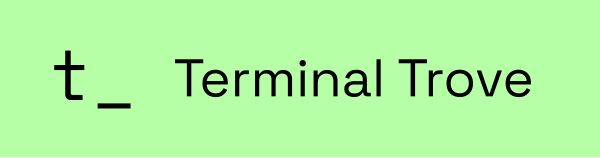

# herdr


<p align="center">
  
</p>

<p align="center">
  <a href="https://herdr.dev">herdr.dev</a> · <a href="#install">install</a> · <a href="https://herdr.dev/docs/quick-start/">quick start</a> · <a href="https://herdr.dev/docs/">docs</a> · <a href="#sponsors">sponsors</a>
</p>

<p align="center">
  <a href="LICENSE"></a>
  <a href="https://github.com/kazuph/herdr/releases"></a>
  <a href="https://github.com/kazuph/herdr/stargazers"></a>
  <a href="https://github.com/kazuph/herdr/releases/latest"></a>
  <a href="https://github.com/kazuph/homebrew-tap"></a>
  <a href="https://x.com/herdrdev"></a>
</p>

---

https://github.com/user-attachments/assets/043ec09f-4bdd-41d5-aee0-8fda6b83e267

**agent multiplexer that lives in your terminal.**

- **every agent at a glance** — blocked, working, done. real terminal views, not a wrapped interpretation.
- **detach, agents keep running** — reattach from any terminal, or over ssh. sessions survive restarts.
- **agents can use herdr too** — a pure socket api: agents spawn panes, read output, wait on each other. [agent skill →](https://herdr.dev/docs/agent-skill/)
- **keyboard and mouse, both first-class** — tmux-style prefix keys *and* click, drag, split. pick per moment, not per tool.
- **plugins** — extend panes and workflows. [browse the marketplace →](https://herdr.dev/plugins/)
- **one rust binary, no electron** — runs in whatever terminal you already use.

---

## install

install the published binary with Homebrew:

```bash
brew install kazuph/tap/herdr
```

or run it without a global install:

```bash
npx @kazuph/herdr
# or
bunx @kazuph/herdr
```

prebuilt Linux and macOS binaries are available from [releases](https://github.com/kazuph/herdr/releases).

to build from source:

```bash
git clone https://github.com/kazuph/herdr
cd herdr
just build
install -m 0755 target/release/herdr ~/.local/bin/herdr
```

## quick start

```bash
herdr
```

run your agents, split panes, walk away. `ctrl+b q` detaches, `herdr` reattaches. [quick start →](https://herdr.dev/docs/quick-start/)

## docs

everything lives at [herdr.dev/docs](https://herdr.dev/docs/): [quick start](https://herdr.dev/docs/quick-start/) · [concepts](https://herdr.dev/docs/concepts/) · [supported agents](https://herdr.dev/docs/agents/) · [keyboard](https://herdr.dev/docs/keyboard/) · [configuration](https://herdr.dev/docs/configuration/) · [session state](https://herdr.dev/docs/session-state/) · [remote](https://herdr.dev/docs/persistence-remote/) · [plugins](https://herdr.dev/docs/plugins/) · [socket api](https://herdr.dev/docs/socket-api/)

## sponsors

herdr is built full-time, in the open. sponsoring directly funds development, stability, and the path to a real agent runtime.

### gold

<a href="https://terminaltrove.com/"></a>

[**→ become a sponsor**](https://github.com/sponsors/ogulcancelik) · enterprise / partnership: hey@herdr.dev · see [SPONSORS.md](./SPONSORS.md) for tiers. thank you 🐑

## agent instructions

if you are an ai agent helping with this repository, read [`AGENTS.md`](./AGENTS.md) before making changes and read [`CONTRIBUTING.md`](./CONTRIBUTING.md) before opening issues or PRs.

## development

```bash
git clone https://github.com/kazuph/herdr
cd herdr
cargo build --release

just test        # unit tests
just check       # formatting, tests, and maintenance checks
```

### optional terminal browser

`tb` is a real browser displayed inside a Herdr terminal pane. The bundled
`apps/terminal-browser` starts from zenbu-labs/terminal-browser 0.7.1 and adds
Herdr mouse fixes, zoom controls, and gtx support. Use this bundled version;
the upstream tb lacks these Herdr integration changes.

On macOS Apple silicon, install or update a prebuilt, Developer ID signed copy:

```bash
herdr tb install
herdr tb install --version 0.7.1 # select an exact published version
herdr tb status
```

The corresponding Herdr version must already be installed, with `~/.local/bin`
on PATH. No Rust, Node, or local tb build is needed. Installs live in
`~/.local/share/herdr/terminal-browser/<version>`; `~/.local/bin/tb` is a wrapper
for that version. The bundled plugin provides “Open terminal-browser (right
split)”. Updating re-registers that plugin, preserves old versions and running
browsers, and leaves the previous launcher/registration in place on failure.
During activation, SIGINT/SIGTERM take effect after registration or rollback
finishes. When registration fails and the install rolls back, a manual plugin
link/disable/unlink made in the meantime is kept and reported as a conflict;
the rollback never overwrites it.
`tb upgrade` runs `herdr tb install`; it never invokes the upstream installer
or changes editor/AI agent configuration. `status` prints the installed version
and location even when its latest-release lookup fails (exit status 1).

Only stable, complete `kazuph-tb-vMAJOR.MINOR.PATCH` releases in `kazuph/herdr`
are selected. SHA256SUMS detects download corruption; it is not independent
proof of the author, since the archive and sums come from the same release.
The macOS app is signed by Developer ID Application: KAZUHIRO HOMMA
(67M8FDFZ28), without Apple notarization. Managed Macs may require additional
organizational approval. Linux and Intel Macs return an explicit unsupported
error. On saved machines such as the Mac mini or work Mac, use
`herdr tb install` rather than copying local build output.

For source development, retain the build, checks and local plugin link:

```bash
just terminal-browser-install
```

That build requires a Developer ID Application identity and verifies pinned
download checksums. The development plugin still uses the repository build.

To publish a new bundled tb version, configure repository secrets
`MACOS_DEVELOPER_ID_P12` (base64 of the Developer ID certificate **with its
private key**) and `MACOS_DEVELOPER_ID_P12_PASSWORD`, then push a unique tag
`kazuph-tb-vMAJOR.MINOR.PATCH` on the approved source commit. The root workflow
`.github/workflows/kazuph-tb-release.yml` builds on a GitHub-hosted Apple silicon
Mac, checks the certificate Team ID, signs through the existing release script,
and removes its temporary keychain while restoring the previous search list.
Missing signing credentials fail closed. It publishes only the archive and
SHA256SUMS, as a complete release without taking Herdr's “latest” marker.
Existing release tags (including drafts left by failed publication) are refused;
review a failed draft explicitly rather than silently replacing its contents.
The nested upstream R2/worker release workflow is not used.

## license

Herdr is dual-licensed:

1. Open source: GNU Affero General Public License v3.0 or later (AGPL-3.0-or-later).
2. Commercial: commercial licenses are available for organizations that cannot comply with AGPL.

Contact: hey@herdr.dev
